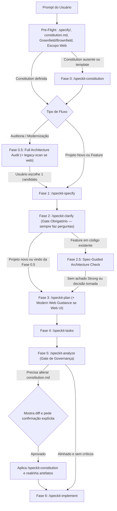

<div align="center">
  
  <h1>🌱 SpecKit Flow</h1>
  <h3><em>Inicie projetos, adicione features e aprofunde a arquitetura — do prompt único ao código validado com Spec Kit.</em></h3>
</div>

<p align="center">
  <a href="https://github.com/menino-dev/speckit-flow"></a>
  <a href="https://antigravity.google/docs/plugins"></a>
  <a href="https://github.com/github/spec-kit"></a>
  <a href="https://github.com/googlechrome/modern-web-guidance"></a>
  <a href="./LICENSE"></a>
</p>

**SpecKit Flow** é um plugin para **Google Antigravity** (agente principal + skills) que automatiza o ciclo completo de **Spec-Driven Development (SDD)** usando [GitHub Spec Kit](https://github.com/github/spec-kit). Basta descrever o projeto, a feature ou o objetivo arquitetural em um único prompt para orquestrar todas as fases — com perguntas obrigatórias de clarificação, diagnóstico de módulos profundos (*deep modules*), consulta a práticas modernas da web e confirmação explícita antes de qualquer alteração na constituição do projeto.

---

## Sumário

- [Escolha o seu fluxo](#escolha-o-seu-fluxo)
- [O que vem no plugin](#o-que-vem-no-plugin)
- [Comece agora](#comece-agora)
- [Como usar](#como-usar)
- [Pipeline detalhado fase a fase](#pipeline-detalhado-fase-a-fase)
- [Exemplos práticos de prompts](#exemplos-práticos-de-prompts)
- [Estrutura do repositório](#estrutura-do-repositório)
- [Guardrails e boas práticas](#guardrails-e-boas-práticas)
- [Créditos, suporte e licença](#créditos-suporte-e-licença)

---

## Escolha o seu fluxo

O `speckit-flow` detecta automaticamente o contexto do repositório e a intenção do seu prompt para acionar o caminho mais enxuto e seguro:

| O que você precisa | Modo automático | Resultado |
| --- | --- | --- |
| **Criar um projeto do zero** *(Greenfield)* | [Novo Projeto](#1-novo-projeto-greenfield) | Inicializa `.specify/`, cria `constitution.md`, especifica, clarifica, planeja, gera tarefas, analisa e implementa |
| **Adicionar feature em código existente** *(Brownfield)* | [Adição de Feature](#2-adição-de-feature-brownfield) | Fluxo SDD completo + checagem arquitetural guiada pela `spec.md` antes do plano (*"torne a mudança fácil primeiro"*) |
| **Refatorar ou auditar arquitetura** | [Auditoria Arquitetural](#3-auditoria-arquitetural-ou-modernização-web) | Relatório visual com diagramas Mermaid e selos de força → você escolhe **1 candidato** → fluxo SDD completo |
| **Modernizar padrões web legados** | [Modernização Web](#3-auditoria-arquitetural-ou-modernização-web) | Varredura `legacy-scan` filtrada por rubrica + guias oficiais do Chrome/MDN → fluxo SDD completo |
| **Apenas diagnosticar sem alterar código** | [`/improve-codebase-architecture`](#uso-avulso-improve-codebase-architecture) | Relatório visual somente-leitura + sessão de design (*grilling*) pronta para virar spec depois |

---

## O que vem no plugin

| Componente | Caminho | Função |
| --- | --- | --- |
| **Agente Principal** | `agents/speckit-flow.md` | Agente selecionável (`mainAgent: true`) que conduz todo o ciclo SDD automaticamente a partir do seu prompt |
| **Skill Orquestradora** | `skills/speckit-flow/SKILL.md` | Slash command `/speckit-flow` executável em qualquer conversa padrão do Antigravity |
| **Skill Arquitetural** | `skills/improve-codebase-architecture/SKILL.md` | Diagnóstico somente-leitura de *deep vs. shallow modules*, *seams*, *deletion test*, foco em `git log` e ADRs |
| **Referência de Design** | `skills/improve-codebase-architecture/references/codebase-design.md` | Vocabulário padronizado (*module*, *interface*, *depth*, *seam*, *adapter*, *locality*, *leverage*) e guardrail YAGNI |
| **Integração Web Moderna** | Via herança (`inheritCustomizations: true`) | Aciona automaticamente `modern-web-guidance` e `chrome-extensions` em tarefas Web UI / MV3 quando instalados |

---

## Comece agora

### Pré-requisitos

- **Google Antigravity** (App, IDE ou CLI `agy`)
- **Python 3.11+** e **[uv](https://docs.astral.sh/uv/)** para instalar o **Spec Kit CLI**:
  ```bash
  uv tool install specify-cli
  ```
- *(Opcional, recomendado para projetos Web UI e Extensões Chrome)* — Plugin oficial **Modern Web Guidance**:
  ```bash
  agy plugin install modern-web-guidance-plugin
  ```

### Instalação

#### Opção 1 — Via Antigravity CLI (Recomendada)

```bash
agy plugin install https://github.com/menino-dev/speckit-flow
```

#### Opção 2 — Instalação manual global (todos os projetos)

Disponibiliza o agente `speckit-flow` e as skills `/speckit-flow` e `/improve-codebase-architecture` em **todos os repositórios** da sua máquina (App, IDE e CLI):

**Windows (PowerShell):**
```powershell
git clone https://github.com/menino-dev/speckit-flow.git "$HOME\.gemini\config\plugins\speckit-flow"
```

**macOS / Linux:**
```bash
git clone https://github.com/menino-dev/speckit-flow.git ~/.gemini/config/plugins/speckit-flow
```

#### Opção 3 — Instalação local (apenas em um projeto)

Para versionar e compartilhar com o time dentro de um repositório específico:

```bash
git clone https://github.com/menino-dev/speckit-flow.git .agents/plugins/speckit-flow
```

### Verificar a instalação

```bash
# Validar manifesto, agente e skills
agy plugin validate ~/.gemini/config/plugins/speckit-flow --strict

# Conferir se o agente speckit-flow aparece na lista
agy agents
```

No Antigravity App, abra **Customizations > Installed** — o plugin **SpecKit Flow** aparece ativo com 1 agente (`speckit-flow`) e 2 skills (`speckit-flow`, `improve-codebase-architecture`).

---

## Como usar

Você pode acionar o fluxo de **duas maneiras** (com exatamente o mesmo comportamento):

### Forma 1 — Como Agente Principal *(ideal para sessões dedicadas)*

1. **Antigravity App / IDE**: selecione **`speckit-flow`** no seletor de agentes da conversa.
2. **Antigravity CLI**:
   ```bash
   agy --agent speckit-flow
   ```
   *(ou digite `/agents` dentro de uma sessão ativa e selecione `speckit-flow`).*
3. Envie **apenas o prompt descrevendo o projeto ou a feature**. O agente dispara todo o pipeline automaticamente.

### Forma 2 — Como Slash Command *(em qualquer conversa normal)*

Sem precisar trocar de agente, digite diretamente no chat:

```text
/speckit-flow <descreva o novo projeto, a feature ou o pedido de auditoria>
```

### Uso avulso: `/improve-codebase-architecture`

Para fazer uma inspeção arquitetural rápida **sem iniciar implementação nem editar código**:

```text
/improve-codebase-architecture
```

---

## Pipeline detalhado fase a fase



### Pre-Flight (Detecção automática)

Antes de qualquer ação, o `speckit-flow` inspeciona o diretório do projeto:
1. **Spec Kit (`.specify/`)**: se a pasta ainda não existe, inicializa automaticamente via `specify init --here --force --non-interactive --integration copilot --script ps` (ou `sh` em Unix).
2. **Constituição (`.specify/memory/constitution.md`)**: considera **indefinida** se o arquivo não existir, estiver vazio ou ainda contiver placeholders de template (`[PROJECT_NAME]`, `[PRINCIPLE_1_NAME]`, `[CONSTITUTION_VERSION]`).
3. **Greenfield vs. Brownfield**: verifica se já existe código-fonte no repositório para decidir se ativa o check arquitetural.
4. **Escopo Web / Extensão Chrome**: ativa `modern-web-guidance` apenas em tarefas de HTML/CSS/DOM/JS client-side (e `chrome-extensions` para Manifest V3), ignorando totalmente em backend puro, CLI, infra ou scripts.

### Fase 0 — `/speckit-constitution` *(condicional)*
- Executada automaticamente **apenas quando o projeto ainda não tem constitution definida**.
- Infere princípios a partir do repositório/prompt, faz 2–4 perguntas curtas se necessário e grava `.specify/memory/constitution.md` (`v1.0.0`).
- Em projetos Web, já inclui a política de **Browser Support / Baseline**.

### Fase 0.5 — Auditoria Completa / Modernização *(somente no Modo Auditoria)*
- Roda `/improve-codebase-architecture` em modo `full-audit`: analisa commits recentes (`git log`), aplica o **Teste da Exclusão (*deletion test*)** e respeita `constitution.md`, `GLOSSARY.md` e `docs/adr/`.
- Gera um **relatório visual com diagramas Mermaid antes/depois** e selos **`Strong`**, **`Worth exploring`** ou **`Speculative`**, indicando uma **Top Recommendation**.
- **Para** e aguarda você escolher **1 candidato** (ou registrar um ADR em `docs/adr/` caso rejeite uma sugestão permanentemente).
- Em pedidos explícitos de modernização web ampla, combina com `modern-web-guidance legacy-scan`.

### Fase 1 — `/speckit-specify`
- Cria a pasta da feature (`specs/NNN-nome-curto/`), atualiza `.specify/feature.json`, escreve `spec.md` (User Stories priorizadas, cenários BDD, requisitos funcionais testáveis, casos de borda, critérios mensuráveis) e valida `checklists/requirements.md`.
- **Nunca escreve código-fonte nesta fase.**

### Fase 2 — `/speckit-clarify` *(Gate Interativo Obrigatório)*
- **Sempre faz perguntas direcionadas ao usuário** (3 a 5 perguntas de alto impacto, mínimo 2) com opção recomendada e justificativa sobre escopo, fluxos, estados de erro/vazio, dados, acessibilidade ou casos de borda — garantindo que nenhuma informação fique subentendida.
- Grava todas as respostas na seção `## Clarifications` do `spec.md`, atualiza os requisitos afetados e revalida o checklist.

### Fase 2.5 — Check Arquitetural Guiado pela Spec *(somente Brownfield)*
- Inspeciona **apenas os módulos existentes que a `spec.md` vai tocar**.
- **Regra anti-burocracia**: se nenhum candidato **`Strong`** passar no *deletion test*, registra 1 linha para o `research.md` e segue direto ao `/speckit-plan` sem te interromper.
- Se houver candidato **`Strong`**, exibe o card com diagrama Mermaid e pede 1 escolha rápida:
  1. Incluir como **Fase Preparatória** no `plan.md` / `tasks.md`;
  2. Salvar como backlog futuro e seguir com a feature como está;
  3. Rejeitar permanentemente e gravar um ADR em `docs/adr/`.

### Fase 3 — `/speckit-plan`
- Executa `setup-plan`, avalia o **Constitution Check** e gera `plan.md`, `research.md`, `data-model.md`, `contracts/` e `quickstart.md`.
- **Em tarefas Web UI**: executa obrigatoriamente `modern-web-guidance search` + `retrieve` antes de escolher bibliotecas ou inventar soluções, priorizando APIs nativas modernas da web (`<dialog>`, `popover`, CSS Anchor Positioning, Container Queries, `@starting-style`, etc.) e registrando os `guide-id`s e fallbacks no `research.md`.

### Fase 4 — `/speckit-tasks`
- Executa `setup-tasks` e gera `tasks.md` organizado por fases (*Setup → Foundational → User Stories por prioridade → Polish*) no formato estrito `- [ ] T001 [P?] [US?] Descrição com caminho de arquivo`.

### Fase 5 — `/speckit-analyze` *(Gate de Governança Constitucional)*
- Audita consistência cruzada entre `spec.md`, `plan.md`, `tasks.md` e `constitution.md` (modo somente-leitura).
- **Se for necessária qualquer alteração na `constitution.md`**: o agente **para**, mostra exatamente o que mudará (texto atual vs. proposto, incremento semântico `MAJOR`/`MINOR`/`PATCH` e justificativa) e **aguarda sua confirmação explícita** antes de aplicar `/speckit-constitution` ou avançar para a implementação.
- Também interrompe e pede confirmação se encontrar apontamentos `CRITICAL` ou `HIGH`.

### Fase 6 — `/speckit-implement`
- Verifica os checklists, implementa `tasks.md` fase a fase marcando cada tarefa concluída como `[x]`, valida conformidade com os guias de `modern-web-guidance` (em projetos Web), executa build/typecheck/testes e entrega o relatório final com links clicáveis.

---

## Exemplos práticos de prompts

### 1. Novo Projeto (Greenfield)

```text
/speckit-flow Criar uma API REST em Node.js + TypeScript para gestão de tarefas
com autenticação JWT, filtros por status/prioridade e testes automatizados.
```

> Como o diretório ainda não tem `.specify/` nem `constitution.md`, o agente inicializa o Spec Kit, cria a constituição com você, gera a spec, faz perguntas de clarificação e entrega até o código validado.

### 2. Adição de Feature (Brownfield)

```text
/speckit-flow Adicionar um modal acessível de confirmação antes de excluir projetos,
com suporte a teclado, animação suave e feedback de erro caso a exclusão falhe.
```

> Usa a `constitution.md` existente, clarifica detalhes com você, verifica se algum módulo afetado precisa ser aprofundado (Fase 2.5), consulta `modern-web-guidance` para `<dialog>` / `@starting-style` / acessibilidade no `/speckit-plan` e implementa tudo seguindo `tasks.md`.

### 3. Auditoria Arquitetural ou Modernização Web

```text
/speckit-flow Auditar a arquitetura do projeto e identificar o melhor módulo raso
para aprofundar neste ciclo.
```

```text
/speckit-flow Fazer uma varredura de modernização web no diretório src/ para
substituir padrões CSS/DOM legados por APIs nativas modernas.
```

---

## Estrutura do repositório

```text
speckit-flow/
├── plugin.json                                     # Manifesto do plugin Antigravity (v1.2.0)
├── LICENSE                                         # Licença MIT
├── README.md                                       # Este guia de uso
├── assets/
│   └── logo.png                                    # Ícone oficial do plugin (512×512 PNG transparente)
├── agents/
│   └── speckit-flow.md                             # Agente principal (mainAgent: true)
└── skills/
    ├── speckit-flow/
    │   └── SKILL.md                                # Protocolo completo do pipeline SDD
    └── improve-codebase-architecture/
        ├── SKILL.md                                # Diagnóstico arquitetural (spec-guided & full-audit)
        └── references/
            └── codebase-design.md                  # Vocabulário de módulos profundos e deletion test
```

---

## Guardrails e boas práticas

- **Sem código prematuro**: nenhuma linha de código da aplicação é alterada antes da Fase 6 (`/speckit-implement`).
- **Sem commits automáticos**: o agente nunca executa `git commit` ou `git push` sem seu comando explícito.
- **1 candidato arquitetural por sessão**: em auditorias de arquitetura, ataque apenas 1 módulo por vez para manter a janela de contexto limpa e precisa.
- **Memória arquitetural com ADRs**: ao rejeitar uma sugestão de refactor por motivo permanente, aceite registrar o ADR em `docs/adr/` para não receber a mesma sugestão no futuro.
- **Telemetria opcional do Modern Web Guidance**: a CLI do `modern-web-guidance` coleta métricas anônimas de uso; para desativar, defina `DISABLE_TELEMETRY=1` no ambiente.

---

## Créditos, suporte e licença

- **Reportar bug ou sugerir melhoria**: [Abrir issue](https://github.com/menino-dev/speckit-flow/issues/new)
- **Construído sobre e inspirado por**:
  - [GitHub Spec Kit](https://github.com/github/spec-kit) — metodologia e toolkit de Spec-Driven Development
  - [AI Hero / Matt Pocock (`improve-codebase-architecture` & `codebase-design`)](https://www.aihero.dev/skills-improve-codebase-architecture) — metodologia de aprofundamento de módulos (*deep modules*, *seams* e *deletion test*)
  - [GoogleChrome / Modern Web Guidance](https://github.com/googlechrome/modern-web-guidance) — base oficial de boas práticas modernas da plataforma web

Distribuído sob a [Licença MIT](./LICENSE).
